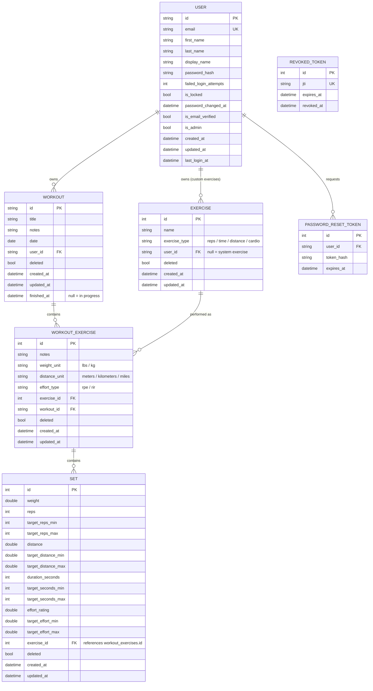

# Database design

This document describes the Postgres schema for `workout-log-app`, how it's
defined, and the reasoning behind the main design decisions. It's generated
from the code-first EF Core model in
[`backend/WorkoutLogAPI/WorkoutLogAPI/Models`](../backend/WorkoutLogAPI/WorkoutLogAPI/Models)
and
[`backend/WorkoutLogAPI/WorkoutLogAPI/Data/WorkoutDbContext.cs`](../backend/WorkoutLogAPI/WorkoutLogAPI/Data/WorkoutDbContext.cs).

## Overview

- **Engine:** PostgreSQL (Postgres 16 locally via Docker; [Neon](https://neon.tech/)
  serverless Postgres in staging and production).
- **Approach:** Code-first with EF Core. The C# entity classes in `Models/`
  are the source of truth; migrations in `Migrations/` are generated from
  them (`dotnet ef migrations add ...`) and applied automatically on
  startup via `DatabaseExtensions.SeedDatabaseAsync` (`context.Database.MigrateAsync()`).
- **Naming convention:** PascalCase C# properties are mapped explicitly to
  `snake_case` table and column names using `[Table]`/`[Column]` data
  annotations, which is idiomatic Postgres style.
- **IDs:** Most primary keys are `string` GUIDs (`Guid.NewGuid().ToString()`),
  generated in application code rather than by the database. `Exercise`,
  `WorkoutExercise`, and `Set` use plain auto-incrementing `int` identities
  instead, since they don't need to be unguessable/globally unique.
- **Soft deletes:** `Exercise`, `Workout`, `WorkoutExercise`, and `Set` all
  have a `deleted` boolean flag rather than being physically removed from the
  table. Queries throughout the service layer filter with `!Deleted`. The
  one exception is `Workout`, `WorkoutExercise`, and `Set` rows belonging to
  an *unfinished* workout (`finished_at IS NULL`): `WorkoutService` hard-deletes
  those instead, since they have no history worth preserving yet — see
  [Why soft deletes?](#why-soft-deletes).
- **Auditing:** Entities that represent user-facing data implement
  `IAuditableEntity` (`CreatedAt` / `UpdatedAt`). `WorkoutDbContext` overrides
  `SaveChanges`/`SaveChangesAsync` to automatically stamp `UpdatedAt` on any
  modified auditable entity.

## Entity-relationship diagram

## Table reference

### `users`

Application accounts. Authentication is handled with a bcrypt password hash
and JWTs (see [`AuthService`](../backend/WorkoutLogAPI/WorkoutLogAPI/Services/AuthService.cs)
and [`JwtService`](../backend/WorkoutLogAPI/WorkoutLogAPI/Services/JwtService.cs)).

- `id` (PK, string GUID)
- `email` (unique index, `AddUserEmailUniqueConstraint` migration)
- `first_name`, `last_name`, `display_name` (optional)
- `password_hash` — bcrypt hash, never the plaintext password
- `failed_login_attempts` / `is_locked` — basic brute-force lockout support
- `password_changed_at`, `is_email_verified`, `is_admin`, `last_login_at`
- `created_at` / `updated_at` — audited via `IAuditableEntity`

### `exercises`

A catalog of exercises (e.g. "Barbell Bench Press"). Can be a **system
exercise** (`user_id` is `null`, seeded in `ExerciseSeedData`, visible to
everyone) or a **custom exercise** created by a specific user.

- `id` (PK, `int` identity)
- `name` (non-unique index for lookups/search)
- `exercise_type` — the `ExerciseType` enum (`Reps`/`Time`/`Distance`/`Cardio`),
  stored as its lowercase string name via an EF value converter (same
  pattern as `weight_unit`/`effort_type` below). Fixed at creation time —
  there's no endpoint to change an existing exercise's type, since it
  determines which fields are meaningful for every `workout_exercises`/`sets`
  row that references it (see
  [Why is exercise type stored on exercises, not workout_exercises or sets?](#why-is-exercise-type-stored-on-exercises-not-workout_exercises-or-sets)).
  `Reps` (weight + reps, e.g. "Barbell Bench Press"), `Time` (weight + a
  timed hold, e.g. "Plank"), `Distance` (weight + distance, e.g. "Farmer's
  Carry"), and `Cardio` (distance + duration, no weight, e.g. "Running")
- `user_id` (FK to `users.id`, nullable, `ON DELETE RESTRICT`)
- `deleted`, `created_at`, `updated_at`
- **Check constraint** `CK_Exercise_SystemExercise_NotDeleted`: `user_id IS
  NOT NULL OR deleted = false`. System exercises (`user_id IS NULL`) can
  never be soft-deleted, so the stock list stays intact for every user.

### `workouts`

A single logged workout session for a user.

- `id` (PK, string GUID)
- `title`, `notes` (optional)
- `date` — a `DateOnly` (Postgres `date`, no time component), since a
  workout is associated with a calendar day rather than a specific instant
  (see the `UseDateOnlyForWorkoutDate` migration)
- `user_id` (FK to `users.id`, `ON DELETE RESTRICT`)
- `deleted`, `created_at`, `updated_at`
- `finished_at` (nullable) — `null` while the workout is in progress; set
  to the current UTC time by `WorkoutService.FinishWorkout` (`PATCH
  /api/workouts/{id}/finish`). A user can have at most one in-progress
  (`finished_at IS NULL`, not deleted) workout at a time —
  `WorkoutService.CreateWorkout` enforces this in application code rather
  than a DB constraint. Powers autosave: the frontend creates a workout
  immediately with top-level fields only, persists exercise/set edits via
  `PUT`, and the `GET /api/workouts/active` endpoint lets the UI resume an
  in-progress workout (e.g. after navigating away and back) by querying for
  `finished_at IS NULL`.

### `workout_exercises`

A join/detail entity: one exercise as it was performed within one workout
(e.g. "Bench Press, set with 135 lbs"). This is where per-workout notes and
the weight unit used for that instance live, separate from the exercise
catalog entry itself.

- `id` (PK, `int` identity)
- `notes` (optional, specific to this workout instance)
- `weight_unit` — the `WeightUnit` enum (`Lbs`/`Kg`), stored as its
  lowercase string name (`"lbs"`/`"kg"`) via an EF value converter so the
  column is human-readable and matches the API's JSON representation,
  rather than the default numeric enum value. Nullable — `null` for
  `Cardio` exercises, which never have a weight (see
  [`exercises`](#exercises) above)
- `distance_unit` — the `DistanceUnit` enum (`Meters`/`Kilometers`/`Miles`),
  stored the same way as `weight_unit` (lowercase string name via an EF
  value converter). Nullable — only set for `Distance` and `Cardio`
  exercises, which are the only types with a distance field on their sets
- `effort_type` — the `EffortRatingType` enum (`Rpe`/`Rir`), stored the
  same way as `weight_unit` (lowercase string name via an EF value
  converter). Determines how every set's `effort_rating` on this
  exercise-within-a-workout is interpreted and validated (see
  [`sets`](#sets) below)
- `exercise_id` (FK to `exercises.id`, `ON DELETE RESTRICT`)
- `workout_id` (FK to `workouts.id`, `ON DELETE RESTRICT`)
- `deleted`, `created_at`, `updated_at`

### `sets`

An individual set performed for a `workout_exercises` row — which of its
fields are populated depends on the parent exercise's `exercise_type` (see
[`exercises`](#exercises) above); the backend's cross-field validation
(`WorkoutService.GetExerciseAndSetValidationErrors`) rejects a set with
values that don't match its exercise's type (e.g. `reps` on a `Cardio`
set). Despite the FK property being named `ExerciseId` in code, it
actually points at `workout_exercises.id`, not `exercises.id` — a set only
makes sense in the context of one specific exercise-within-a-workout.

- `id` (PK, `int` identity)
- `weight` (nullable `double`) — set on `Reps`, `Time`, and `Distance`
  sets; always `null` for `Cardio`
- `reps` (nullable `int`) — set on `Reps` sets only
- `target_reps_min` / `target_reps_max` (nullable `int`) — optional goals
  for `reps`, shown alongside the actual value and used to colour-code it
  in the UI (see [frontend-architecture.md](frontend-architecture.md#set-targets)).
  Not required to be a matched pair; either bound can be set independently
- `distance` (nullable `double`) — set on `Distance` and `Cardio` sets only
- `target_distance_min` / `target_distance_max` (nullable `double`) —
  optional goals for `distance`, same matched-pair rules as the reps
  targets above
- `duration_seconds` (nullable `int`) — set on `Time` and `Cardio` sets
  only. Stored as a total whole-second count rather than separate
  minutes/seconds columns; the frontend splits it into an mm:ss pair of
  inputs for display/editing
- `target_seconds_min` / `target_seconds_max` (nullable `int`) — optional
  goals for `duration_seconds`, same matched-pair rules as the reps/distance
  targets above
- `effort_rating` (nullable `double`, used by the 1RM calculator) —
  interpreted as RPE (Rate of Perceived Exertion, 0.5 steps) or RIR (Reps
  in Reserve, whole numbers) depending on the parent
  `workout_exercises.effort_type`. RIR is only allowed on `Reps` exercises
  (see [`workout_exercises`](#workout_exercises) above)
- `target_effort_min` / `target_effort_max` (nullable `double`) — optional
  goals for `effort_rating`, same matched-pair rules as the other target
  fields above and the same RPE/RIR step rules as `effort_rating` itself
- `exercise_id` (FK to `workout_exercises.id`, `ON DELETE RESTRICT`)
- `deleted`, `created_at`, `updated_at`

### `password_reset_tokens`

Short-lived tokens for the forgot-password flow. Only the hash of the token
is stored, not the raw value emailed to the user.

- `id` (PK, `int` identity)
- `user_id` (FK to `users.id`, indexed, not enforced with a DB-level FK
  constraint navigation in the model)
- `token_hash`
- `expires_at`

### `revoked_tokens`

A denylist of JWT IDs (`jti`) that were explicitly invalidated (e.g. via
logout) before their natural expiry, so `JwtService` can reject an
otherwise still-valid, unexpired token.

- `id` (PK, `int` identity)
- `jti` (unique index)
- `expires_at` — mirrors the token's own expiry, so old rows can eventually
  be pruned
- `revoked_at`

## Design notes

### Why soft deletes?

`Exercise`, `Workout`, `WorkoutExercise`, and `Set` are all soft-deleted
(`deleted` flag) instead of using a hard `DELETE`. This preserves history
(e.g. an exercise removed from a past workout doesn't corrupt that
workout's record) and avoids needing `ON DELETE CASCADE` chains through
workouts → workout_exercises → sets. It's also why every foreign key in the
schema uses `DeleteBehavior.Restrict`: rows are never expected to be hard
deleted by a database-level cascade, only marked `deleted = true` (or
explicitly hard-deleted in application code, in strict child-then-parent
order — see below) so an accidental hard delete of a parent row is blocked
instead of silently cascading.

**Exception — unfinished workouts:** the rationale above only applies once
a workout is *finished*, since that's the point at which it becomes a
historical record worth preserving. While a workout is still unfinished
(`finished_at IS NULL`), the frontend autosaves on every edit
(`PUT /workouts/{id}`), and soft-deleting on each autosave would leave a
growing trail of dead, orphaned `workout_exercises`/`sets` rows for a
workout that was never actually finished. So `WorkoutService` hard-deletes
exercises/sets removed from an unfinished workout (and hard-deletes the
whole workout if it's deleted before being finished), and only switches to
soft deletes once `finished_at` is set. Because every FK stays
`DeleteBehavior.Restrict`, these hard deletes are done manually in the
service layer in child-then-parent order (sets, then workout_exercises,
then workouts) rather than relying on a database-level cascade.

### Why are exercises separate from workout_exercises?

`exercises` is a catalog (name + owner), while `workout_exercises` captures
the point-in-time details of using that exercise in a specific workout
(notes, weight unit, effort rating type). This lets a user's exercise
history be queried across all workouts (`WorkoutService.GetExerciseHistory`)
by joining on `exercise_id`, while still letting each workout's
notes/weight unit/effort rating type vary independently.

### Why is effort rating type (RPE/RIR) stored per exercise, not per set?

`effort_type` lives on `workout_exercises` alongside `weight_unit`, for the
same reason: both represent a *unit of measurement* for the exercise as a
whole, not a per-set choice. Switching between RPE and RIR mid-exercise
(the way `weight_unit` already couldn't switch mid-exercise between lbs/kg)
wouldn't make sense — a lifter picks one effort-rating scale and uses it
consistently for every set of that exercise. Storing it at the exercise
level also keeps the UI simple: one toggle per exercise card, rather than a
rating-type picker on every individual set.

### Why is exercise type stored on exercises, not workout_exercises or sets?

Unlike `effort_type` above, `exercise_type` is an intrinsic property of the
exercise itself, not a per-use choice — "Running" is always cardio, "Bench
Press" is always weight/reps. It's fixed at creation and there's no
endpoint to change it later, since allowing that would require retroactively
rewriting every `workout_exercises`/`sets` row that already references the
exercise (e.g. clearing `reps` and backfilling `distance`/`duration_seconds`
for every historical set). Storing it on the catalog entry also means the
"Add Exercise" and "Change Exercise" drawers can group/filter the exercise
list by type without joining through every workout.

### System vs. custom exercises

A single `exercises` table serves both the global stock list (seeded at
startup by `ExerciseSeedData`, `user_id = null`) and user-created custom
exercises (`user_id = <owner>`). The check constraint enforces that system
rows can never be soft-deleted, protecting the shared seed data from being
hidden by one user's action while still letting users delete their own
custom exercises.

### GUID vs. int primary keys

`users` and `workouts` use string GUIDs generated in application code. This
avoids leaking sequential/guessable IDs for user-facing resources exposed
directly in API routes and URLs. `exercises`, `workout_exercises`, and
`sets` use simple `int` identities since they're nested resources always 
accessed through their parent workout, so enumerability isn't a practical concern.

### Migrations

Notable migrations beyond the initial schema:

- `MergeExerciseTables` — consolidated what were originally separate system
  and custom exercise tables into the single `exercises` table described
  above.
- `AddFinishedAtToWorkouts` — added the `finished_at` column and backfilled
  existing rows with `COALESCE(updated_at, created_at)` so historical
  workouts aren't retroactively treated as in-progress.
- `AddEffortTypeToWorkoutExercisesAndEffortRatingToSets` — renamed
  `sets.rpe` to `sets.effort_rating` and added `workout_exercises.effort_type`
  (default `"rpe"`), so existing data keeps its original meaning without a
  manual backfill.
- `AddTargetRepsAndTargetEffortToSets` — added the nullable
  `target_reps_min`/`target_reps_max`/`target_effort_min`/`target_effort_max`
  columns to `sets` for the set-targets feature.
- `AddExerciseTypeAndCardioFields` — added `exercises.exercise_type`
  (default `"reps"`, so existing exercises keep their original
  weight/reps behaviour), `workout_exercises.distance_unit`, and the
  nullable `distance`/`target_distance_min`/`target_distance_max`/
  `duration_seconds`/`target_seconds_min`/`target_seconds_max` columns on
  `sets`, for the Time/Distance/Cardio exercise types. Also widened
  `workout_exercises.weight_unit` to nullable, since `Cardio` exercises
  have no weight.
